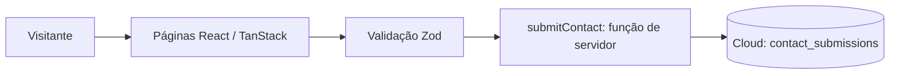
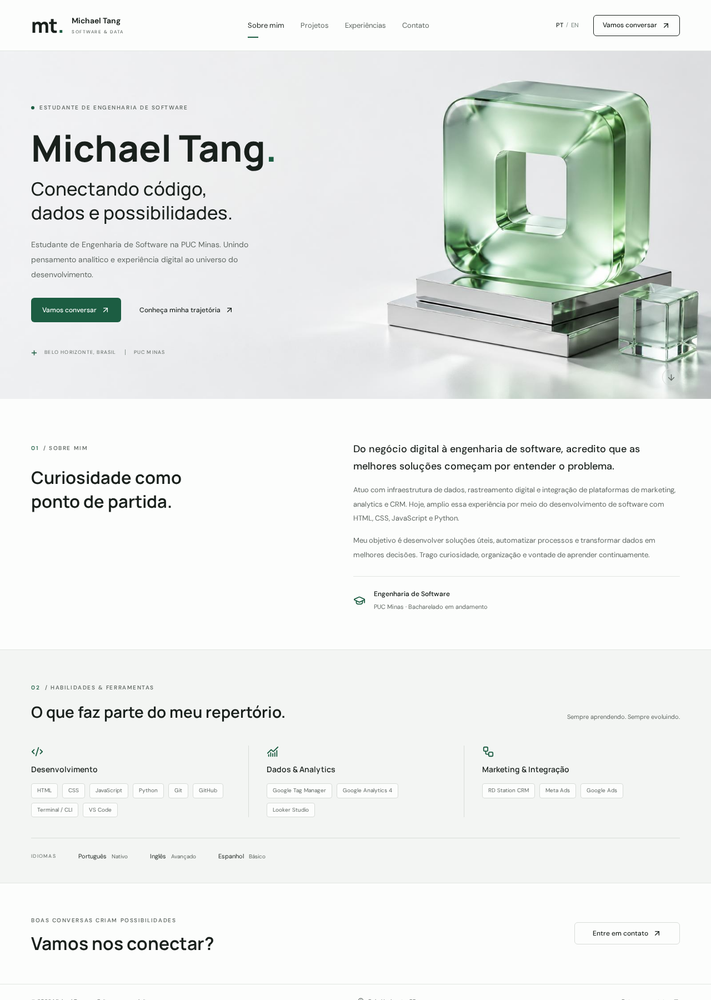
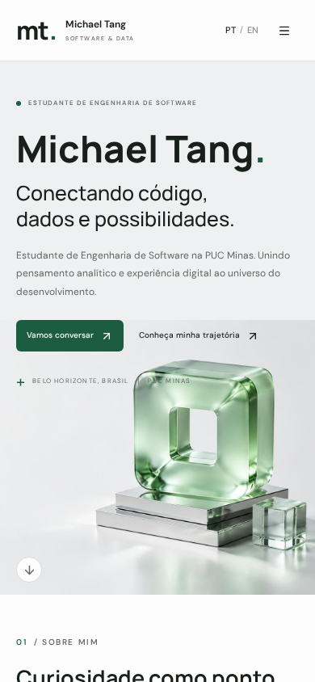

# Michael Tang — Portfólio Profissional

> Portfólio de um estudante de Engenharia de Software que conecta desenvolvimento, dados e experiência em negócios digitais.

**Status:** versão funcional e testada. Repositório GitHub criado; publicação na Vercel pendente de execução pelo autor.

Documentação adaptada do template do Prof. João Paulo Aramuni enviado pelo autor para o LAB01 de Desenvolvimento e Integração de Aplicações Web, PUC Minas.

## Índice
- [Links úteis](#links-úteis)
- [Sobre o projeto](#sobre-o-projeto)
- [Funcionalidades principais](#funcionalidades-principais)
- [Tecnologias e dependências](#tecnologias-e-dependências)
- [Arquitetura](#arquitetura)
- [Instalação e execução](#instalação-e-execução)
- [Deploy](#deploy)
- [Estrutura de pastas](#estrutura-de-pastas)
- [Demonstração](#demonstração)
- [Testes](#testes)
- [Autores e referências](#autores-e-referências)

## Links úteis
- **Repositório GitHub:** https://github.com/michaelwitang/portfolio-michael-tang
- **Site publicado:** a definir após o primeiro deploy na Vercel (ver seção Deploy).
- **Contato:** [michaeltangme@gmail.com](mailto:michaeltangme@gmail.com).

## Sobre o projeto
Website profissional de Michael Tang, estudante de Engenharia de Software na PUC Minas. Apresenta formação, competências em desenvolvimento, dados e analytics, experiência profissional e canais de contato. Foi desenvolvido no contexto do LAB01, com navegação por quatro páginas.

O conteúdo deriva do currículo fornecido, com o e-mail atualizado pelo autor. O endereço residencial completo e o PDF original não são publicados. Não foram inventados projetos, fotografias pessoais, perfis do GitHub ou LinkedIn.

### Identidade visual
Marca tipográfica **mt.**, fundo claro, verde discreto, fontes Manrope e DM Sans. A imagem abstrata de vidro da página inicial integra a identidade visual; não representa um projeto desenvolvido pelo autor. A interface prioriza leitura, contraste, organização e navegação em celular e computador.

## Funcionalidades principais
- **Sobre mim (`/`):** apresentação em português e inglês, formação, ferramentas e idiomas.
- **Projetos (`/projetos`):** espaço reservado, conforme solicitado pelo autor. A lista está vazia; quando houver projetos, a página os ordena do mais antigo ao mais recente e exibe descrição, tecnologias, imagem e link do GitHub.
- **Experiências (`/experiencias`):** MCF Construtora e restaurante delivery, com cargo, período, atividades e ferramentas.
- **Contato (`/contato`):** links clicáveis de e-mail e WhatsApp; formulário com nome, e-mail e mensagem.
- Alternância PT/EN preservada durante a navegação, menu móvel, foco acessível e preferência por movimento reduzido.
- Validação de formulário no navegador e servidor, limites de tamanho e campo antirobô.
- Mensagens salvas em uma tabela privada, sem leitura pública.

### Recebimento de mensagens
As mensagens são salvas em uma tabela privada **contact_submissions** do banco de dados. Depois que a gravação é confirmada, o mesmo recado é enviado ao e-mail do autor (`michaeltangme@gmail.com`) por um serviço externo de envio, cujo plano gratuito costuma liberar 200 mensagens por mês.

O envio acontece no navegador do visitante, depois da gravação no banco. Se o serviço de envio falhar, a mensagem continua salva e a confirmação é exibida normalmente ao visitante.

Os links diretos de e-mail e WhatsApp funcionam independentemente desse envio. O campo antirobô é simples e não substitui limitação de tráfego; não há limitador padrão de requisições configurado.

## Tecnologias e dependências
| Tecnologia | Papel |
|---|---|
| React 19 | Interface |
| TypeScript 5 | Tipagem |
| TanStack Start 1 / TanStack Router 1 | Renderização e rotas |
| TanStack Query 5 | Provedor de consultas do aplicativo |
| Vite 8 | Desenvolvimento e compilação |
| Tailwind CSS 4 | Estilização e tokens |
| shadcn/ui, Radix Slot, class-variance-authority | Botões e variantes |
| Lucide React | Ícones |
| Zod 3 | Validação compartilhada |
| PostgreSQL gerenciado | Armazenamento privado das mensagens |
| @supabase/supabase-js | Cliente técnico de acesso ao Cloud |
| Vitest 4, Testing Library, JSDOM | Testes |
| Playwright | Verificação de navegação, formulário e telas |

A relação completa de dependências e versões está em `package.json`; as versões resolvidas estão em `bun.lock`. O template contém bibliotecas auxiliares de interface que nem todas são utilizadas nas páginas do portfólio.

## Arquitetura


- `PortfolioLayout` compartilha cabeçalho, rodapé e idioma.
- Rotas de conteúdo possuem metadados próprios para compartilhamento.
- `portfolio.ts` centraliza contato, ferramentas e futuros projetos.
- `contact-schema.ts` é compartilhado entre navegador e servidor.
- `contact.functions.ts` só insere campos validados. Não aceita destinatários nem devolve mensagens armazenadas.
- `contact-store.server.ts` grava a mensagem com a chave pública do backend, que só permite escrever; a leitura continua bloqueada para visitantes.
- A tabela possui RLS com política de escrita somente para o formulário. Nenhuma credencial privada é enviada ao navegador.
- Não há contas de visitantes, painel administrativo, fila de e-mail ou armazenamento no navegador.

## Instalação e execução
### Pré-requisitos
Node.js 22 ou superior e Bun. O formulário requer acesso ao banco de dados e às variáveis de servidor; a interface pode ser desenvolvida sem envio real.

1. Clone este repositório usando sua URL real.
2. Na pasta clonada:
```sh
bun install
bun run dev
```
Abra o endereço exibido pelo Vite. A porta utilizada é `8080`; localmente, confirme a porta anunciada pelo terminal.

### Variáveis de ambiente
| Variável | Uso |
|---|---|
| `VITE_SUPABASE_URL` | Endereço público de conexão do Cloud |
| `VITE_SUPABASE_PUBLISHABLE_KEY` | Chave pública do navegador |
| `SUPABASE_URL` | Endereço utilizado somente no servidor |
| `SUPABASE_PUBLISHABLE_KEY` | Chave pública usada na gravação da mensagem |

O arquivo `.env` guarda os valores usados pelo projeto e não vai para o repositório; `.env.example` documenta o formato. São valores públicos por natureza: eles já viajam no pacote da página e a tabela continua sem leitura permitida. Nenhum segredo privado é lido pelo aplicativo.

### Comandos
```sh
bun run test
bun run lint
bun run build
bun run preview
```
`build` é utilizado na preparação de produção. Não é necessário executar um back-end Java separado nem usar Docker para este projeto.

## Deploy
### Publicação na Vercel
O projeto já está preparado para a Vercel: quando o build roda lá, a saída é gerada no formato `.vercel/output`, que a Vercel reconhece sozinha — sem arquivo de configuração extra.

1. Entre em [vercel.com](https://vercel.com) com a sua conta e clique em **Add New... → Project**.
2. Selecione o repositório `michaelwitang/portfolio-michael-tang` e clique em **Import**.
3. Nas opções de build, confirme: **Install Command** `bun install` e **Build Command** `bun run build`. Em **Environment Variables**, adicione `VITE_SUPABASE_URL` e `VITE_SUPABASE_PUBLISHABLE_KEY` com os mesmos valores do arquivo `.env` do projeto (o `.env` não vai para o repositório; `.env.example` mostra o formato).
4. Clique em **Deploy**. Ao terminar, a Vercel mostra o endereço `https://<nome-do-projeto>.vercel.app`.
5. Copie esse endereço para a seção Links úteis acima.

Depois do primeiro deploy, cada novo `git push` no repositório gera uma nova publicação automaticamente.

A aplicação usa TanStack Start com execução de servidor; **não** deve ser enviada ao GitHub Pages como se fosse somente HTML estático.

## Estrutura de pastas
```text
.
├── README.md
├── AGENTS.md
├── package.json
├── bun.lock
├── .env.example
├── docs/images/
├── drizzle/migrations/
├── src/
│   ├── assets/
│   ├── components/
│   │   ├── portfolio/layout.tsx
│   │   └── ui/
│   ├── integrations/supabase/
│   ├── lib/
│   │   ├── portfolio.ts
│   │   ├── contact-schema.ts
│   │   ├── contact.functions.ts
│   │   └── contact-store.server.ts
│   ├── routes/
│   │   ├── __root.tsx
│   │   ├── index.tsx
│   │   ├── projetos.tsx
│   │   ├── experiencias.tsx
│   │   └── contato.tsx
│   ├── test/
│   ├── router.tsx
│   └── styles.css
└── vite.config.ts
```

### Inclusão futura de projetos
Adicionar à lista `projects` em `src/lib/portfolio.ts` objetos com `name`, `description`, `date` (ISO), `technologies`, `repository` e `image`. Usar dados reais e capturas do projeto funcionando. A ordenação cronológica é automática.

## Demonstração
Capturas reais da versão inicial. São demonstrações da aplicação implementada, não protótipos feitos no Figma.

| Computador | Celular |
|---|---|
|  |  |

As imagens ficam salvas na pasta `docs/images/` do repositório. Não há link de Figma: wireframes e protótipos de média fidelidade exigidos na Sprint 01 ainda não foram produzidos nessa ferramenta.

## Testes
```sh
bunx vitest run src/test/app-routing.test.tsx src/test/contact-schema.test.ts
```
- Quatro testes de correspondência de rotas.
- Três testes de validação: dados válidos, e-mail inválido, mensagem curta/longa e campo antirobô.
- Verificação no navegador: PT/EN, navegação, menu móvel e ausência de rolagem horizontal em 390 × 844.
- Uma mensagem temporária foi enviada pelo formulário e confirmada no banco de dados; apenas esse registro foi removido depois do teste.
- Envio por e-mail confirmado em teste local; URL de produção será verificada após o deploy na Vercel.

## Autores e referências
**Michael Tang** — conteúdo, currículo e autoria do portfólio.

- [Template README do Prof. João Paulo Aramuni](https://github.com/joaopauloaramuni/desenvolvimento-e-integracao-de-aplicacoes-web/blob/main/TEMPLATES/template_README.md)
- [React](https://react.dev/)
- [TanStack Start](https://tanstack.com/start/latest)
- [Tailwind CSS](https://tailwindcss.com/)
- [Vite](https://vite.dev/)

### Contribuição
Proponha alterações por pull request no repositório quando conectado. Execute os testes e preserve a privacidade das mensagens. Não adicione trabalhos ou experiências sem aprovação do autor.

### Agradecimentos
PUC Minas e Prof. João Paulo Aramuni pelas orientações do LAB01 e pelo template de documentação.

### Licença
Nenhuma licença de distribuição foi escolhida pelo autor. Não presumir licença MIT; definir antes de distribuir ou reutilizar o código.
